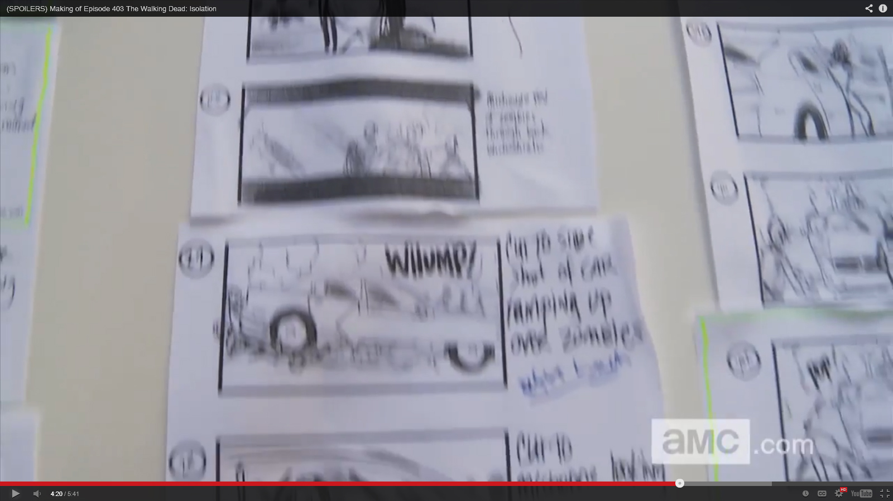

Something cool I thought I would share! The &#8216;making of&#8217; video for one of the Walking Dead episodes I boarded this season actually shows them using my boards on location. So cool to see. I rarely get to see them being used. This was for a gigantic zombie herd sequence and car sequence 🙂 Enjoy!

<iframe src="https://www.youtube-nocookie.com/embed/9H6uRC6K_pc" title="YouTube video" loading="lazy" allowfullscreen></iframe>

